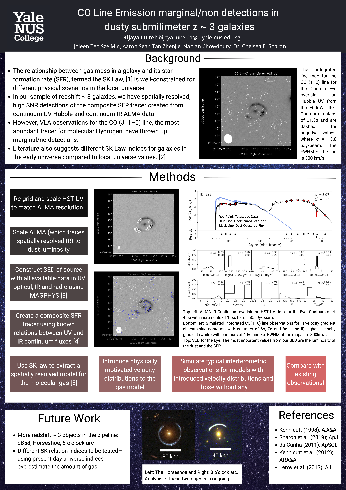

A poster presentation I gave based on preliminary results from my BSc thesis. This was mostly similar to the previous poster from IPS2022, although I updated the technical details to better match the intended audience (astronomers at an IAU conference). I'd also done some observational mockups by this point.  

<figure>

<figcaption>A digital version of the original poster.</figcaption>

 </figure>